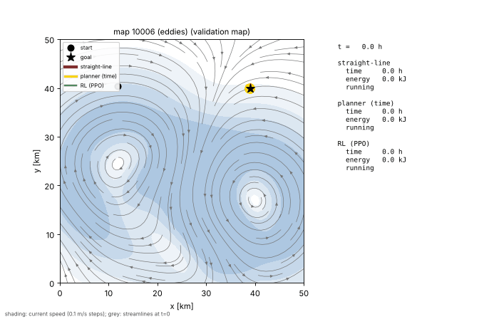

# glider-zermelo-rl

Energy-aware reinforcement-learning navigation of an underwater glider through synthetic ocean currents (a Zermelo navigation variant), benchmarked against a naive straight-line heading and a classical grid planner (Dijkstra).



*Validation map 10006, picked by a fixed rule (first validation map where straight-line fails and planner and RL both succeed). Red: straight-line (captured by an eddy). Orange: time-optimal planner. Green: PPO agent (training seed 0).*

Status: research prototype (DRAFT results). See [docs/HANDOFF.md](docs/HANDOFF.md) for the honest reading of the numbers and [docs/STATUS.md](docs/STATUS.md) for the build log.

## Results in one table (200 held-out test maps, DRAFT)
| method | success | time [h]* | energy vs straight-line** |
|---|---|---|---|
| straight-line (nose at goal) | 65.5% | 26.1 | 1.00 |
| Dijkstra planner (full current knowledge) | 95.0% | 23.5 | 0.99 |
| PPO, 5 seeds | 80.4 +/- 2.7% | 24.9 | 0.99 +/- 0.02 |
| PPO + LR decay + KL limit (exploratory) | 85.0 +/- 2.6% | 24.4 | 0.97 +/- 0.01 |

\* on the maps every method solves (120 maps; the exploratory row is from the 119-map set that also requires it to succeed); ** per-map ratio on maps both solve. RL clearly beats the naive heading but not the full-knowledge planner; energy savings are small under the assumed energy model. Details, CIs and caveats: [docs/HANDOFF.md](docs/HANDOFF.md).

## What is simulated
- 50 x 50 km domain, glider speed 0.3 m/s through the water, 10-minute control steps, at most 400 steps.
- Currents from stream functions (divergence-free): random Gaussian eddies + weak drift, a meandering jet, and a time-varying double gyre used only as a held-out test field.
- Energy per step = (hotel power + turning power x |heading change|/pi) x dt. This is an assumed model, not a physical glider model (see docs/ASSUMPTIONS.md).

## Quick start (CPU only)
```bash
python -m venv .venv && . .venv/bin/activate
pip install -r requirements.txt && pip install -e . --no-deps
pytest -q                                              # 45 tests
python -m glider_rl.train --seed 0 --run my_run        # one PPO run (2M steps; measured ~19 min with 5 runs sharing 4 cores)
python -m glider_rl.evaluate --split val --methods straight planner_time --runs my_run --out results/eval/my_eval.csv
python run_all.py                                      # regenerate every table/figure/GIF from saved raw results
# animate the committed model (training seed 0) against the baselines on any map seed:
python -m glider_rl.animate --map 10010 --methods straight planner_time rl --rl-run results/models/main_s0.zip --out results/figures/my_demo
```
All numbers live in `configs/default.yaml`; override any of them with `--set a.b=value`.

## Layout
| path | content |
|---|---|
| `src/glider_rl/fields.py` | stream-function current fields, map (task) generation from a seed |
| `src/glider_rl/dynamics.py` | glider kinematics (RK2) and the assumed energy model |
| `src/glider_rl/env.py` | Gymnasium environment (observation and reward documented in the docstring) |
| `src/glider_rl/baselines.py`, `planner.py` | straight-line, random, Dijkstra planner + path follower |
| `src/glider_rl/train.py`, `experiments.py` | PPO training, all experiment runs |
| `src/glider_rl/evaluate.py` | evaluation on fixed map splits, paired summary with bootstrap CIs |
| `src/glider_rl/plots.py`, `animate.py`, `run_all.py` | figures and animations from saved results |
| `results/` | raw per-episode CSVs, summaries, figures, demo trajectories, one small model (`results/models/main_s0.zip`) |
| `docs/` | spec, protocol, assumptions, teaching notes (LEARN.md), handoff |
